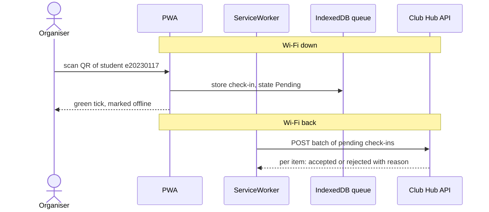

# Offline-first check-in for Debate Night (Amphi A)

## Sequence diagram

## Conflict rules

| # | Case | Winner | Organiser sees | Stored on the server |
|---|------|--------|----------------|----------------------|
| 1 | same student scanned at door 1 and door 2 | The earliest scan by **corrected time** (see rule 5); tie broken by smaller `localId`. The student counts once. | At scan time: normal green tick, "offline". After sync, the loser phone gets `rejected: ALREADY_CHECKED_IN (door 1, 19:03)`, shown as an information line, not an error. The student is inside, no action needed. | One check-in row for (eventId, studentId). The losing `localId` is kept in a duplicates log with its device and time, so the count is auditable. |
| 2 | registration cancelled on the server before the scan synced | Server. A cancellation is a newer fact than the phone's snapshot. | Green tick at the door (the snapshot said registered). After sync a red line: `rejected: REGISTRATION_CANCELLED` with the student id, added to a "to resolve" list for the event owner. | No attendance row. A rejection record (localId, studentId, reason, times) is kept for the audit trail. |
| 3 | student not registered at all | Server. Walk-ins are not auto-created. | If the snapshot has no such student: amber "not on the list" immediately, still queued with the flag `notInSnapshot`, so the organiser may let them in. After sync: `rejected: NOT_REGISTERED` in the "to resolve" list. | No attendance row. A rejection record with reason NOT_REGISTERED. An event owner can later add a manual walk-in. |
| 4 | upload retried after a timeout | server (first copy) | nothing new | the server keeps a set of applied localIds; a second POST with the same localId returns "accepted" again without a second record |
| 5 | phone clock 7 minutes wrong | Server time. The device clock never decides who wins or whether a scan is "on time". | Nothing at the door. At sync, if skew is over 5 minutes, a banner: `phone clock is 7 min off`. The scan is not rejected for being "late" or "early". | `scannedAt` as sent by the phone, `receivedAt` from the server, and `correctedAt = scannedAt + (serverNow - batch.sentAt)`, plus `clockSkewSeconds` (about 420). Ordering and check-in window use `correctedAt`. |

## Which field makes a retried upload idempotent?

**`QueuedCheckIn::localId`.** It is a UUID created on the device at the moment
of the scan and never changed. Two reasons for a device-made UUID:

1. It works with no network and no coordination: two phones offline at two doors
   cannot ask the server for an id, and random UUIDs do not collide.
2. It is stable across retries. If the reply is lost, the phone does not know
   whether the server applied the item, so it sends the same batch again with
   the same `localId`s. The server looks the id up in its set of applied ids:
   already there means answer `accepted` again and do nothing else.
   The check-in is therefore applied **at most once**.

## Link to the quality scenarios

| Scenario | Offline-first | Why |
|---|---|---|
| QAS-01 Availability | **Improves** | Check-in keeps working when the Wi-Fi or the server is down. |
| QAS-02 Performance of check-in at the door | **Improves** | The green tick depends on a local write, not on a round trip over bad Wi-Fi. |
| QAS-03 Usability | **Mixed** | The organiser never waits, but must understand the "offline" mark and rejections that arrive later. |
| QAS-04 Security | **Harder** | Student data is cached on the phone, and the device clock and the cached list cannot be trusted, so the server must re-check everything (rules 2, 3 and 5). |
| QAS-05 Modifiability | **Harder** | The sync protocol and conflict rules add code that must stay consistent between the PWA and the server, which puts the 4-hour change target at risk. |
| QAS-06 Portability | **Harder** | ServiceWorker, Background Sync and IndexedDB are not supported equally in every browser, so a fallback retry is needed on Safari, Firefox and others. |

## New scenario: QAS-07 check-in during a 5-minute network outage

| Part | Value |
|---|---|
| Source | An organiser at one of the two doors |
| Stimulus | Scans 30 students in 5 minutes while the phone has no network (the PWA was already loaded and the registration snapshot cached) |
| Environment | Debate Night, Amphi A, peak arrival (about 12 students per minute across two doors) |
| Artifact | PWA, ServiceWorker, IndexedDB queue |
| Response | Each scan is stored in the queue, then shown with a green tick marked offline. When the network returns, the queue uploads without any action by the organiser, and each item gets an accepted or rejected answer. |
| Response measure | Green tick within 300 ms for 95% of scans. 0 scans lost, even if the browser is closed or the phone restarts mid-outage. All queued items uploaded within 30 seconds after the network returns. At most 1 attendance record per student (0 duplicates after a retry). Every rejection shown to the organiser with its reason. |