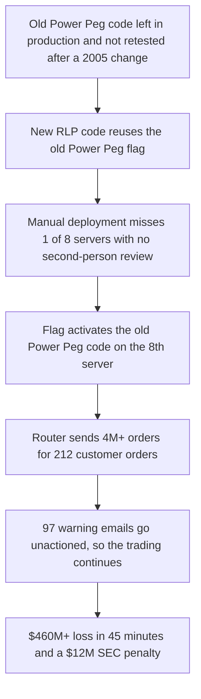

# Failure case analysis · <case> (v1.0, 2026-__-__)
Authors: <member per section>

## 1. Context 
## 2. Timeline
| Date | Event |
|------|-------|

## 3. What failed
<one paragraph>

## 4. Root causes
| # | Root cause | Type | Essential difficulty | Why |
|---|------------|------|----------------------|-----|
| R1 | Old legacy code that  had not been properly removed from the production environment. | Technical | Changeability |  On August 1, 2012, the outdated server activated old obsolete legacy software known as “Power Peg.” ,which the newly introduced software unintentionally triggered this legacy function |
| R2 | New code was not installed on all eight servers. | Process | Complexity | The new code was done manually by human.

## 5. Practices that would have prevented or limited it
| Root cause | Practice | Chapter |
|------------|----------|---------|

## 6. Lessons for ITC Club Hub
1.
2.

## 7. Sources
1. <author or organisation, title, year, URL> (primary)
2. U.S. Securities and Exchange Commission, "SEC Charges Knight Capital With Violations of Market Access Rule", 2013, https://www.sec.gov/news/press-release/2013-222