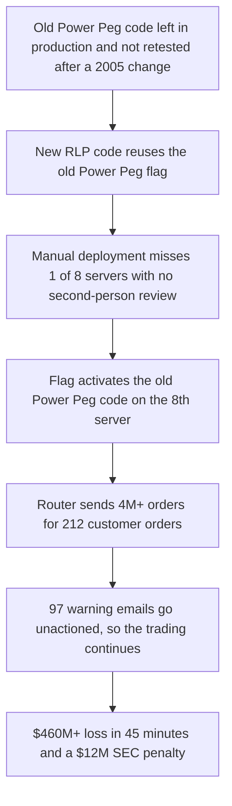

# Failure case analysis · <case> (v1.0, 2026-__-__)
Authors: Lay Pichrattanak ,Siem Khattyavtey ,Ouk Sovanvisal ,Kheng Daniza ,Mengheng Saroeun
## 1. Context 
Knight Capital Group was a major U.S. financial services firm that used automated software to route stock orders to financial markets.

On August 1, 2012, a software deployment failure in its Supplemental Market Access Routing System (SMARS) caused the system to generate millions of erroneous orders. The incident lasted approximately 45 minutes and resulted in a loss exceeding $460 million.

The U.S. Securities and Exchange Commission (SEC) found that Knight lacked adequate software deployment procedures, supervisory controls, and automated safeguards to limit trading risks.
## 2. Timeline
| Date | Event |
|------|-------|

## 3. What failed
<one paragraph>
The failure resulted from defective legacy code, an incomplete software deployment, and inadequate operational safeguards. Knight introduced new RLP functionality that reused a flag associated with the old Power Peg feature. Because one of eight servers did not receive the update, it retained the old code. When the server received certain orders, the defective function repeatedly generated orders. The company also lacked effective automated controls to stop excessive order entry. These failures caused Knight to accumulate unwanted stock positions and lose more than $460 million.

## 4. Root causes
| # | Root cause | Type | Essential difficulty | Why |
|---|------------|------|----------------------|-----|
| R1 | Old legacy code that  had not been properly removed from the production environment. | Technical | Changeability |  On August 1, 2012, the outdated server activated old obsolete legacy software known as “Power Peg.” ,which the newly introduced software unintentionally triggered this legacy function |
| R2 | New code was not installed on all eight servers. | Process | Complexity | The new code was done manually by human. |

## 5. Practices that would have prevented or limited it
| Root cause | Practice | Chapter |
|------------|----------|---------|

## 6. Lessons for ITC Club Hub
1.**Test before deployment.** Test software changes in a separate environment and verify that every server has the correct version.

2.**Don't be lazy.** Removed outdated code or any code that is not used.

## 7. Sources
author or organisation, title, year, URL (primary)
1. U.S. Securities and Exchange Commission, "SEC Charges Knight Capital With Violations of Market Access Rule", 2013, https://www.sec.gov/news/press-release/2013-222
2. CBS News. (2012). Knight Capital avoids collapse with $400M lifeline. https://www.cbsnews.com/news/knight-capital-avoids-collapse-with-400m-lifeline/
3. Varma, J. R. (2013). SEC order explains Knight Capital systems failure. https://www.jrvarma.in/blog/Y2013/Knight-Capital.html 
4. Dolfing, H. (2019). Case study 4: The $440 million software error at Knight Capital. https://www.henricodolfing.ch/en/case-study-4-the-440-million-software-error-at-knight-capital/
5. Badizadegan, N. (2023). The Knight Capital disaster. Speculative Branches. https://specbranch.com/posts/knight-capital/
