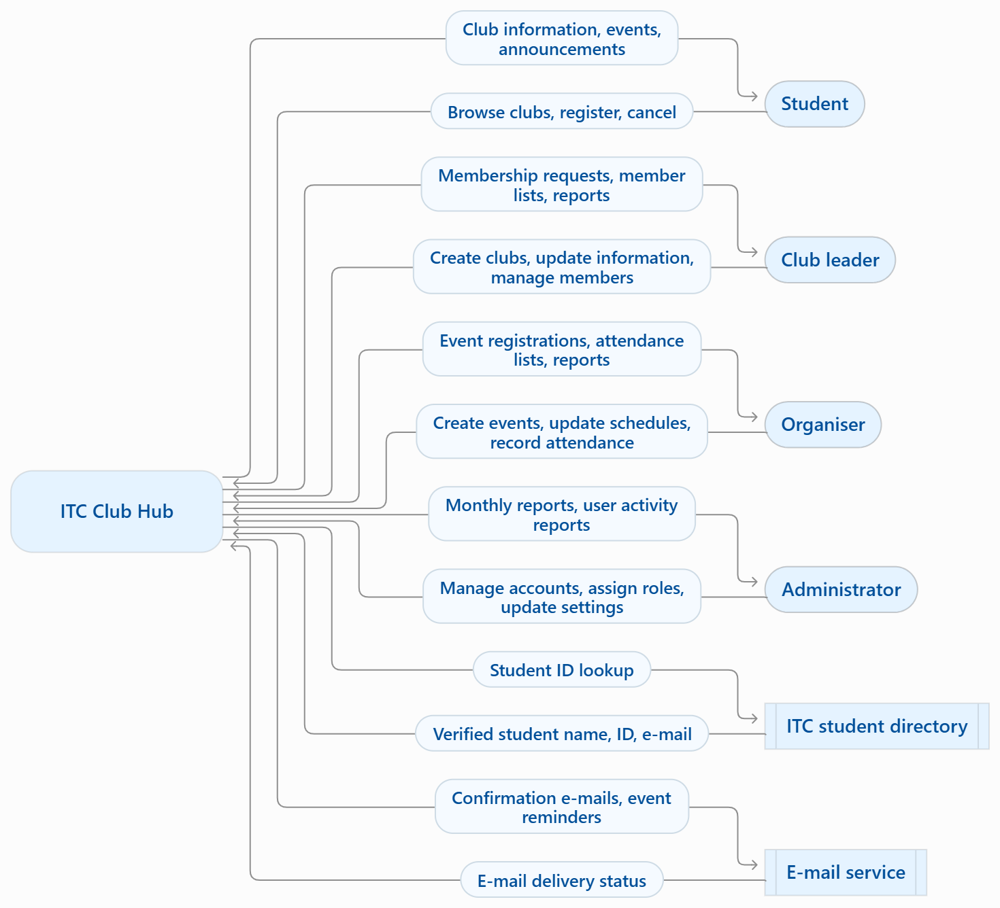
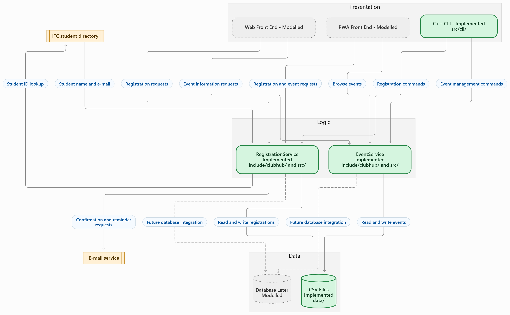

# Lab 02: Application Types & Quality Attributes

**Team: Code Hater**   
**Version:** 1.0  
**Date:** 2026-11-03

---

## Overview

This folder holds everything produced for Lab 02 of the ITC Club Hub project. The lab covers five things: working out how time-sensitive and how always-available different apps need to be, choosing an application type and recording the reasoning in an ADR, writing six measurable quality scenarios, drawing the system's context and three-tier structure in Mermaid, and building a small C++20 event core that is kept separate from the command-line interface.

---

## Repository Layout

```text
itc-club-hub/
├── lab01/                            # Lab-01 deliverables (reference only)
├── lab02/
│   ├── app-classification.md         # Task 1
│   ├── app-quadrant.mmd              # Task 1
│   ├── adr-001-application-type.md   # Task 2
│   ├── quality-scenarios.md          # Task 3
│   ├── context-diagram.mmd / .png    # Task 4
│   ├── architecture.mmd / .png       # Task 4
│   ├── README.md                     # Task 5 (this file)
│   └── challenge/
│       └── offline-checkin.md        # Challenge
├── include/clubhub/
│   ├── event.hpp                     # Task 5
│   ├── event_csv.hpp                 # Task 5
│   └── queued_checkin.hpp            # Challenge
├── src/
│   ├── event.cpp                     # Task 5
│   ├── event_csv.cpp                 # Task 5
│   └── cli/main.cpp                  # Task 5
├── data/events.csv                   # Task 5
└── CMakeLists.txt
```

Adjust this tree if your actual files differ.

---

## Lab-02 Files

| File | Description | Main author |
| :--- | :--- | :--- |
| [`app-classification.md`](app-classification.md) | Compares five real apps by how time-critical and how always-on they must be. | |
| [`app-quadrant.mmd`](app-quadrant.mmd) | Quadrant chart placing Club Hub among the benchmark apps. | |
| [`adr-001-application-type.md`](adr-001-application-type.md) | Decision record comparing Native, PWA, responsive web and cross-platform, scored with weights and must-have criteria. | |
| [`quality-scenarios.md`](quality-scenarios.md) | Six quality scenarios with measurable targets, plus a priority matrix. | |
| [`context-diagram.mmd`](context-diagram.mmd) | Shows the people and outside systems that interact with Club Hub. | |
| [`architecture.mmd`](architecture.mmd) | Shows the presentation, logic and data tiers. | |
| [`challenge/offline-checkin.md`](challenge/offline-checkin.md) | *(Challenge)* Design for checking in without a network connection. | |
| `include/clubhub/event.hpp`, `src/event.cpp` | Event entity and its domain logic. |Ouk Sovanvisal |
| `include/clubhub/event_csv.hpp`, `src/event_csv.cpp` | Reads events from CSV. |Ouk Sovanvisal |
| `src/cli/main.cpp` | `list-events` command-line front end. |Ouk Sovanvisal |
| `data/events.csv` | Sample events used by the CLI. |Ouk Sovanvisal |

---

## Inputs Reused (from Lab 01)

| File | Version (commit hash) |
| :--- | :--- |
| `lab01/team-charter.md` | `TODO` |
| `lab01/decisions.md` | `TODO` |

Get each hash with:

```bash
git log -1 --format=%h -- lab01/team-charter.md
git log -1 --format=%h -- lab01/decisions.md
```

---

## Diagrams

## 1. Context Diagram

The context diagram shows how students, club leaders,
organisers, administrators and external systems
interact with ITC Club Hub.



## 2. Architecture Diagram

The architecture diagram shows the three tiers
of ITC Club Hub: Presentation, Logic and Data.

Green represents components implemented in C++.
Grey represents components that are modelled only.
Orange represents external systems.



---

## Build & Run

```bash
cmake -S . -B build
cmake --build build
```

* **Windows:** `.\build\Debug\clubhub.exe list-events data/events.csv`
* **Linux / macOS:** `./build/clubhub list-events data/events.csv`

---

## Contribution Notes

<!-- Everyone help each other -->

---

## Change Log

| Date | Version | What changed | By |
| :--- | :--- | :--- | :--- |
| 2026-10-31 | 1.0 | Added quality scenarios|Siem Khattyavatey|
| 2026-11-03 | 1.0 | Added app classification, ADR-001, quality scenarios, context and architecture diagrams, event core, `list-events` CLI and this README. |Ouk Sovanvisal |
| 2026-11-03 | 1.0 | commit context-diagram.mmd and architecture.mmd | Siem Khattyavatey |