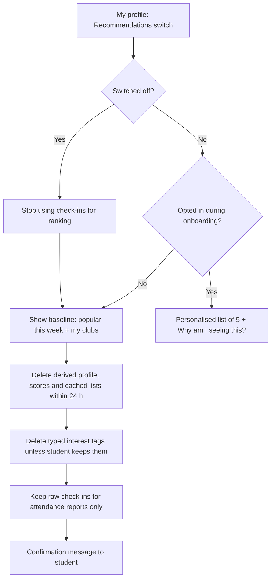

# AI feature proposal: "Recommended for you"
Version 0.1 · 2026-11-11 · Authors: Ouk Sovanvisal (p20250019), team Code Hater

## 1 Problem and non-personalised baseline

**User problem.** Students at ITC do not find out about events that suit them. Posters and chat groups reach only people already in the club, so a student who attended one Debate Night never hears about a related workshop run by another club. The clubs office wants a "Recommended for you" list of five upcoming events per student, chosen from attendance history.

**Non-personalised baseline (no personal data).** Show every student the same two lists:

1. **Popular this week:** the upcoming events with the most registrations in the last 7 days (counts only, no student identity).
2. **Events of my clubs:** upcoming events from clubs the student has chosen to follow. This uses a follow list the student created, not inferred data.

A third, optional slot: **New and small clubs**, chosen by the clubs office on a rotating basis.

The baseline solves the "I never hear about events in my own clubs" part and the "what is happening on campus" part. It does not solve discovery of clubs the student does not know yet. That remaining gap is the only justification for personalisation.

## 2 Data needed

| Field | Source | In inventory? | New purpose / consent? | Minimisation |
|-------|--------|---------------|------------------------|--------------|
| Student pseudonymous ID | Club Hub account | Yes | No (already needed to log in) | Use a hashed ID inside the recommender, never the student ID or name |
| Clubs followed / joined | Club Hub membership | Yes | Yes: new purpose (ranking), notice needed | Store only club IDs, no join dates |
| Event check-ins (event ID, timestamp) | Check-in flow (Lab 02) | Yes | Yes: collected for attendance, now reused for ranking | Keep only the last 6 months; drop the exact time and keep the week |
| Event category / tags | Event form filled by the club | Yes | No (event data, not personal) | Fixed list of at most 10 categories |
| Club size (member count) | Membership table | Yes | No | Aggregate only; used for fairness checks |
| Event location and time | Event form | Yes | No | Used only to filter, never to infer where the student lives |
| Explicit interests ("I like: Tech, Music") | New field in profile | No | Yes: opt-in, optional | Max 5 tags; student can edit or delete any time |
| Student's faculty / year | Student record | No | Yes | **Not collected.** Excluded on purpose (proxy risk, see section 3) |
| Device location, payment, grades | Various | No | n/a | **Not collected** |

**Task 1 decisions that would change.**
- The data inventory gains one new purpose ("ranking recommendations") for check-in records and club membership, and one new field (interest tags).
- The retention rule for check-in records changes from "kept for attendance reports" to "6 months for ranking, attendance reports unchanged".
- The privacy notice and consent text must name the recommender and the opt-out.
- Any earlier decision to keep check-ins only as anonymous counts would have to be reversed for opted-in students, so it is recorded as an exception, not a general change.

## 3 Bias risks

| Risk | Who is harmed | Mitigation | Fairness check (metric, threshold) |
|------|---------------|------------|------------------------------------|
| **Cold start:** new students have no history | First-year and transfer students get an empty or generic list | Fall back to the baseline plus onboarding interest tags; never show an empty list | Share of students with 0 check-ins who still see 5 events must be 100%; click-through of this group at least 80% of the group with history |
| **Popularity feedback loop:** popular events get shown, get more sign-ups, get shown more | Small and new clubs | Cap popularity weight; reserve 1 of the 5 slots for exploration (an event the model would not normally pick) | Gini or concentration: the top 10% of events must receive no more than 40% of impressions |
| **Large clubs crowd out small ones** | Clubs with fewer than 20 members | Per-club cap of 2 events in any list of 5; boost small clubs in tie-breaks | Share of recommendations going to clubs under 20 members must be at least 80% of their share of upcoming events |
| **Attendance as a proxy for money, distance or disability:** students who cannot pay, live far away or cannot reach an upstairs room attend less and so get fewer suggestions | Students with low income, commuters, students with disabilities | Do not use attendance count as a quality signal, only which categories were attended; show event cost, location and accessibility info; never use faculty, address or any proxy | Average number of free events in each list must be at least the share of free events; recommendation diversity must not differ by more than 10% between students with 1 to 2 and 5 or more check-ins |
| **Filter bubble:** the list repeats what the student already does | All students | Exploration slot; "Browse all events" link kept visible | Share of lists with at least 1 category new to the student must be at least 50% |
| **Evening / language mismatch** (event language or time excludes some groups) | Students with jobs, non-Khmer or non-English speakers | Show language and time on each card; do not rank by time of past attendance | Report impression share by event language each month; flag a gap above 15 points |

All checks are computed on aggregate counts, not on individual students.

## 4 Transparency

**"Why am I seeing this?" example** (event: *Debate Night: AI in Education*, Debate Club):

> Recommended because you attended 2 events tagged **Public speaking** in the last 3 months, and this event has the same tag. It is not here because of your faculty, grades or location. This is 1 of 5 suggestions; 1 is chosen to show you something new. **[Turn off recommendations]** **[Show me fewer like this]**

**Ranking inputs the clubs office could publish:**

1. Tags of events the student attended in the last 6 months (and any interest tags they entered).
2. Clubs the student follows.
3. How soon the event happens (sooner ranks higher, within the next 14 days).
4. Popularity this week, with a capped weight.
5. Fairness rules: at most 2 events per club, at least 1 exploration event, small clubs boosted on ties.

**Never used:** name, faculty, year, grades, home address, device location, payment, or any data from outside Club Hub. The monthly fairness numbers from section 3 are published with this description.

## 5 Opt-out design

**Choice: opt-out for the baseline list, opt-in for personalisation using attendance history.** Justification: the baseline needs no personal data, so it is on for everyone. Personalisation reuses attendance data for a new purpose, so the default for it is **off** until the student turns it on during onboarding (a plain-language screen, not pre-ticked). This keeps consent meaningful and means new students are not profiled before they have chosen.

**Where the switch lives:** *My profile → Privacy → Recommendations* (one toggle), also reachable from the "Why am I seeing this?" box.

**What happens to derived data when the student switches it off:**
- The personalised list is replaced by the baseline immediately.
- Derived data (interest scores, the student's recommendation profile, cached lists) is deleted within 24 hours.
- Interest tags the student typed are deleted unless they choose to keep them.
- Raw check-in records stay, because they serve attendance reports, but are no longer used for ranking.
- Switching back on starts from empty; nothing is restored.

## 6 Recommendation

**Decision: GO WITH CONDITIONS**

**Conditions:**
1. Ship the non-personalised baseline first; personalisation only after it is live and measured.
2. Personalisation is opt-in, with the opt-out path in section 5 tested end to end (derived data really deleted within 24 hours).
3. The Task 1 inventory and privacy notice are updated and approved before any check-in record is used for ranking.
4. All fairness checks in section 3 pass on a pilot with at least one month of data; any failed threshold blocks release or triggers a rollback to the baseline.
5. "Why am I seeing this?" and the published ranking description are live from day one.
6. No new data fields beyond section 2 without a new proposal.

**Owner of the fairness check:** the clubs office (a named staff member), who reviews the monthly report; the development team supplies the report and fixes failures within 2 weeks.