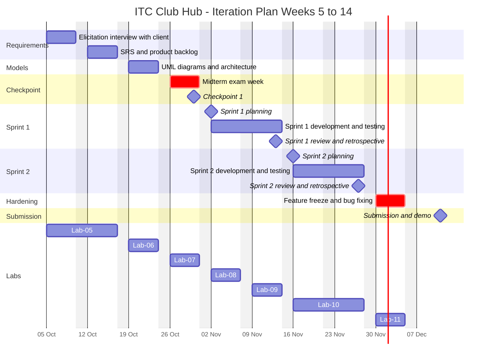

# ITC Club Hub · Iteration Plan (Weeks 5–14)

**Semester start reference:** 2026-10-05  
**Team:** ITC Club Hub  
**Sprint duration:** 2 weeks  
**Team capacity:** 48 hours per sprint

## 1. Gantt chart

## 2. Iteration goals

## 3. Sprint capacity estimation

## 4. Important scheduling decisions

1. Requirements are gathered during Weeks 5–6.
2. UML diagrams and architecture are prepared in Week 7.
3. Week 8 is reserved for the midterm exam and Checkpoint 1. No sprint development is scheduled.
4. Sprint 1 runs during Weeks 9–10.
5. Sprint 2 runs during Weeks 11–12.
6. Week 13 is reserved for hardening, bug fixing and final integration. No new features should be introduced.
7. Week 14 is reserved for final submission and demonstration.

## 5. Review and approval

- Scrum Master: Siem Khattyavatey
- Product Owner: [Name]
- Team member 1: [member names]
- Team member 2: [member names]
- Team member 3: [member names]
- Review date: [Date]
- Status: Proposed